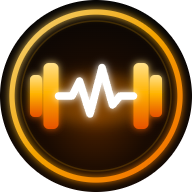
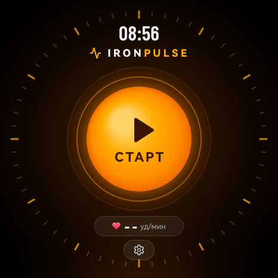
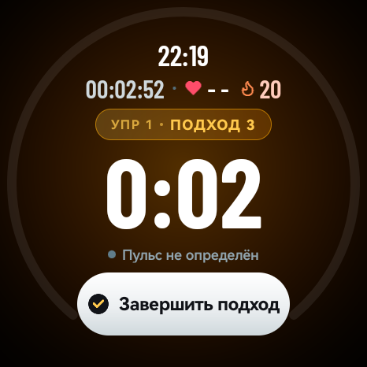
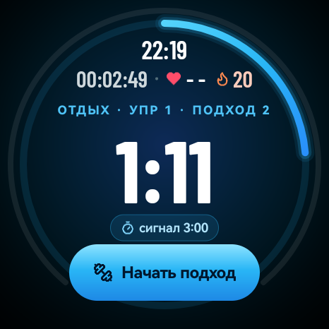
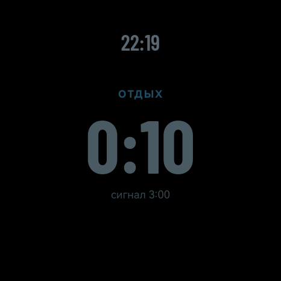
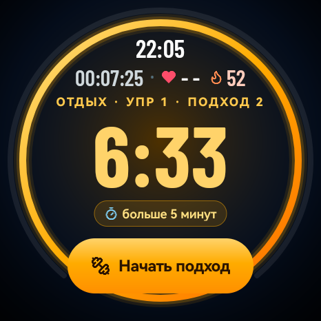
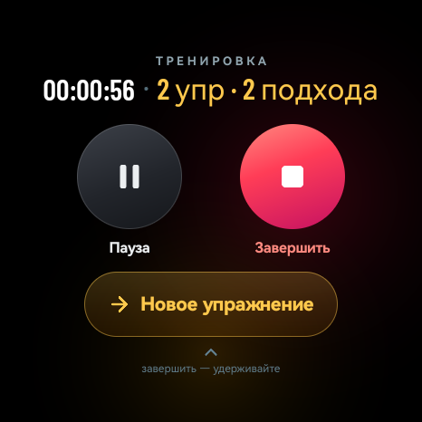
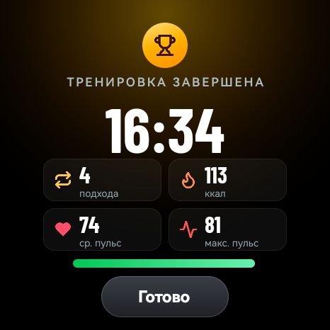

  

<h1 align="center">IronPulse</h1>

  A strength-training timer for Huawei smartwatches — set ↔ rest loop, live heart rate and zones, 
  a dim always-on workout screen and haptic rest signals. Built for the round 466×466 AMOLED of the Watch 4 Pro.

  
  
  
  

  
  
  

> Screenshots are taken from a real Huawei Watch 4 Pro. The UI language is Russian.

## Why

The stock *Workout* app on Huawei watches treats strength training as a plain stopwatch with a heart-rate
readout. IronPulse focuses on the rhythm of a gym session: work, rest, repeat — with the information you
actually glance at between sets.

## Features

- **Set ↔ rest loop** — one big button: *Start set* → set timer → *Finish set* → rest timer → …
- **Exercises** — hold *Start set* for 1.5 s (or use the panel) to start a new exercise; screens show *EX 2 · SET 3*.
- **Rest signals** — counts up with no target; one short pulse at 3:00, two at 5:00.
- **Heart rate** — 1 Hz sensor, a gradient arc whose length is your HR and colour is your zone
  (`<110` recovery, `110–145` working, `>145` peak), plus calories (Keytel formula) next to it.
- **Always-on dim mode** — the screen never drops to the watch face during a workout; after 8 s it dims to
  near-black with the clock and timer in exactly the same place, and wakes on a tap or a rest signal.
- **Can't be dismissed by accident** — swipe-right and Back are blocked from *Start* until *Done*.
- **Crash-safe** — the session is cached; after an app or watch restart the workout resumes where it was.
- **No history by design** — statistics (per set, per rest, zones) are collected for the summary and then discarded.

## Repository layout

| Path | What |
|---|---|
| [`api8/`](api8/) | **The app.** HarmonyOS 3 / API 8, JS FA model (HML/CSS/JS) — runs on Watch 4 Pro |
| [`api8/docs/SPEC.md`](api8/docs/SPEC.md) | Product spec and platform findings ([Russian original](api8/docs/SPEC.ru.md)) |
| [`harmonyos-next/`](harmonyos-next/) | Early prototype for HarmonyOS 5+ (ArkTS, API 18) — first concept, not maintained |
| [`docs/screenshots/`](docs/screenshots/) | Screenshots from the device |

## Getting started

See [api8/README.md](api8/README.md) for the toolchain (DevEco Studio 3.1, HarmonyOS SDK API 8),
build, unit tests, signing and installing on the watch over Wi-Fi debugging.

## Platform notes (learned the hard way)

Huawei Watch 4 Pro runs HarmonyOS 3 on an AOSP base, so a few things behave differently from the docs:

- Third-party apps are frozen when the display is off and `runningLock` is proxied by the system —
  timers and vibrations stop until the screen wakes. IronPulse keeps the display on (dimmed) during a workout.
- `reminderAgent` notifications fire on time, but their vibration may be routed to the paired phone.
- Swipe-right is a window *swipe-to-dismiss* on the Android shell activity — blocked by a custom shell
  activity injected at build time. The crown (Home) can't be intercepted.
- CSS `box-shadow` is not supported, canvas `shadowBlur` fills closed shapes — glows are layered strokes.
- In `<text>` with `` children only the spans are rendered.

## License

[MIT](LICENSE) © 2026 Denis Ushanev. Third-party components keep their own licenses — see [NOTICE](NOTICE) and below.

## Credits

- Font: [Barlow Condensed](https://github.com/jpt/barlow) — SIL Open Font License 1.1
  ([license](api8/entry/src/main/js/MainAbility/common/fonts/OFL.txt)).
- Icons: drawn after [Lucide](https://lucide.dev) outlines (ISC License).
